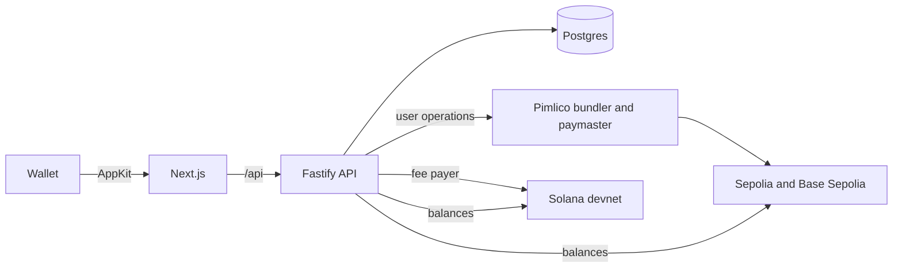

# Meridian Claim & Gate

A multichain dApp for an airdrop and a members-only area. People connect MetaMask, Phantom, Coinbase Wallet or any WalletConnect wallet through one Reown AppKit modal, sign in with SIWE or Sign In With Solana, claim tokens from a Merkle airdrop without paying gas, and open pages that are gated by what their wallets hold.

Runs on Ethereum Sepolia, Base Sepolia and Solana devnet. Testnets only.

## What it covers

| Area | What is built |
| --- | --- |
| Wallets | Reown AppKit with the wagmi (EVM) and Solana adapters in one modal, network switching, mobile deep links through WalletConnect |
| Sign-in | SIWE (EIP-4361) and SIWS messages written by the server, one-time nonces, httpOnly session cookie, one EVM and one Solana wallet per session, ERC-1271/6492 for smart wallets |
| Airdrop | Cumulative Merkle distributor in Solidity and in Anchor, CSV whitelist with row-level errors, new roots published on-chain automatically |
| Gasless claims | EVM: the backend's EIP-7702 smart account sends an ERC-4337 user operation and a Pimlico paymaster pays. Wallets with EIP-5792 `paymasterService` can send the claim themselves through an ERC-7677 proxy. Solana: the backend is the fee payer and pays rent, the wallet only signs |
| Token gating | Rules such as "a pass, or 100 MRD on any network", nested `all`/`any` groups, checked on the server on every request, one-time Telegram invites for wallets that pass |
| Portfolio | Native coins, MRD, Circle test USDC and passes per network, recent transactions with explorer links, mainnet prices for reference |
| Admin | Whitelist upload with a Merkle root preview, root status per network, claims by method, rule editor |

## Try the demo

1. Optional: get a little test ETH or SOL. Claims are gasless, so this is only needed to mint a pass yourself.
2. Connect a wallet and sign the message. It costs nothing.
3. On the Claim page, add your wallet to the demo list. The backend publishes a new root within a few seconds, then claim 250 MRD on each network.
4. Open the Holders Lounge. With 100 MRD anywhere, or a Meridian Pass on Base Sepolia, the page opens and can hand out a Telegram invite.

## How it works

The browser talks only to the Next.js app, which forwards `/api/*` to a Fastify service, so the session cookie stays first-party. Sign-in follows the AppKit SIWX interface, but the server writes the exact message and keeps the nonce, then checks the signature with viem (ECDSA locally, ERC-1271/6492 over RPC for smart wallets) or with an Ed25519 check for Solana. Whitelist changes go into Postgres. A publisher rebuilds both Merkle trees, stores a snapshot under each root and pushes the new root to every network. Proofs are always built from the snapshot that matches the root currently on-chain, so a wallet added a second ago sees "publishing" instead of a proof that would fail.

On EVM the backend key is an EOA delegated to Simple7702Account. A claim is a user operation from that account calling `claim(account, amount, proof)`. The distributor sends tokens only to `account`, so anyone may submit the call, and Pimlico's verifying paymaster pays the gas. On Solana the backend builds a transaction where it is the fee payer and the rent payer and the claimant is a signer. The wallet signs, the backend checks that the message bytes were not changed, adds its signature and sends. Gating rules are JSON evaluated against live balances (viem multicall on EVM, `@solana/kit` RPC on Solana). The response carries a tree of checks with actual and required amounts, and the page content is only included when the rule passes.



## Stack

| Part | Tools |
| --- | --- |
| Web | Next.js 16 (App Router), React 19, Tailwind CSS 4, Motion, Reown AppKit 1.8 with wagmi 3 and viem, TanStack Query |
| API | Fastify 5, Zod, Drizzle ORM on Postgres, permissionless.js for ERC-4337 and EIP-7702, `@solana/kit` |
| Shared code | `packages/core`: Merkle trees, gating rules, chain registry and the CSV parser, used by both web and API |
| EVM contracts | Solidity 0.8.30, OpenZeppelin 5.7, Foundry |
| Solana program | Anchor 1.0, tested with LiteSVM |
| Tooling | TypeScript in strict mode, ESLint, Prettier, Vitest, GitHub Actions, Docker Compose |

The AppKit Solana adapter still speaks `@solana/web3.js` v1. Everything the project owns uses `@solana/kit`; web3.js only appears at the adapter boundary, where a base64 transaction is turned into a `VersionedTransaction` for the wallet to sign.

## Repository layout

```
apps/web            Next.js app: route, claim, lounge, portfolio, admin
apps/api            Fastify API: domain, services, ports, infrastructure, HTTP
packages/core       Merkle trees, gating rules, chains, CAIP-10, CSV parsing
contracts/evm       MeridianToken, MerkleDistributor, AccessPass, Foundry tests and deploy script
contracts/solana    Anchor merkle-distributor program and LiteSVM tests
deployments         Contract addresses per network
```

## Running locally

Requirements: Node 22, Docker, and Foundry if you want a local chain.

```bash
cp .env.example .env            # fill APP_SECRET at least
npm install
docker compose up -d db         # Postgres on 127.0.0.1:5463
npm run dev:api                 # http://localhost:4000
npm run dev:web                 # http://localhost:3000, /api is proxied to the API
```

Wallet connections need `NEXT_PUBLIC_REOWN_PROJECT_ID` in `apps/web/.env.local` (see `apps/web/.env.example`). Without it the site runs read-only.

For a fully local chain, start `anvil --hardfork prague`, deploy with `forge script script/Deploy.s.sol` from `contracts/evm`, write the addresses to a deployments file under the `31337` key and set `ANVIL_RPC_URL`, `SPONSOR_PRIVATE_KEY` and `DEPLOYMENTS_FILE` in `.env`. Without a Pimlico key the sponsor pays gas itself, which is what you want against Anvil.

Everything at once in containers:

```bash
docker compose up --build       # web on http://localhost:3000
```

## Deploying to the testnets

1. Put testnet-only keys in `.env`: `DEPLOYER_PRIVATE_KEY` (holds a little Sepolia and Base Sepolia ETH), `SPONSOR_PRIVATE_KEY` (owns the contracts, needs no ETH with Pimlico), `ETHERSCAN_API_KEY`, `PIMLICO_API_KEY`.
2. EVM: `contracts/evm/script/deploy.sh` deploys to both networks, verifies on Etherscan (Sepolia) and Blockscout (Base Sepolia, Basescan's API is paid for that network) and writes `deployments/testnet.json`.
3. Solana: build with `anchor build` (CI uses `--ignore-keys` because the program keypair is not in the repository), run `contracts/solana/deploy-devnet.sh` with `AUTHORITY_KEYPAIR` set, then `npx tsx --env-file=../../.env scripts/solana-setup.ts <programId>` from `apps/api` to create the MRD mint, initialise the distributor and fund its vault.

Keys never live in the repository. `.env` and keypair files are ignored by git.

Running the demo behind a shared Caddy on a VPS is described in [docs/deploy.md](docs/deploy.md).

## Security notes

- Sign-in messages are built and stored by the server. A nonce is consumed by a single conditional `UPDATE`, so a replayed or edited message is rejected.
- Sessions are opaque random tokens in an httpOnly, SameSite=Lax cookie. Only their SHA-256 hash is stored.
- The wallet paymaster proxy never exposes the Pimlico key. It accepts a short-lived HMAC token bound to one address and chain, decodes the smart account's calldata, and sponsors only a single zero-value claim that matches the server's own proof, with capped gas and fees and one pending sponsorship per wallet. In production, pair it with a Pimlico sponsorship policy and move the per-wallet lock to Redis.
- Upstream errors are stripped of URLs before they are stored or shown, because RPC and bundler URLs can carry API keys.
- Gated content is only serialised into a response after the rule passes for the caller's wallets.
- Rate limits are keyed by client IP, trusting only private-network proxy hops.
- `npm audit` reports advisories in `bigint-buffer` and `stream-json`. Both come from the `@solana/web3.js` v1 tree that the AppKit Solana adapter depends on. In this app web3.js only deserializes transactions built by our own backend, and the API uses it in tests only, so neither code path handles untrusted input. They go away once the adapter moves to `@solana/kit`.

## Tests

```bash
npm test                                      # core and API (Vitest, Postgres via PGlite)
npm run test:e2e -w @mcg/api                  # full flow against a running Anvil node and, if configured, a local Solana validator
cd contracts/evm && forge test                # unit, fuzz and cross-check against backend proofs
cd contracts/solana && cargo test             # LiteSVM, same fixtures as the backend
```

The Solana end-to-end test needs `solana-test-validator` with the program deployed and `scripts/solana-setup.ts` run against it, then `SOLANA_E2E_DEPLOYMENTS`, `SOLANA_E2E_RPC_URL` and `SOLANA_E2E_FEE_PAYER` set. It signs the prepared transaction with `@solana/web3.js`, the same way the AppKit adapter hands it to a wallet. In Docker the validator needs `--security-opt seccomp=unconfined` (it uses io_uring) and `--bind-address` set to the container IP.

The Merkle trees are checked across all three implementations: `packages/core` writes fixtures, and both the Foundry and the Rust suites claim with the exact proofs the backend produces.

## License

MIT
